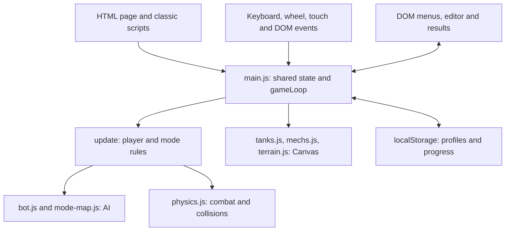

# Current architecture

## Loading and initialization

[index.html](../index.html) defines the page, game canvas, menu and dialog elements, and loads [style.css](../style.css). Its external scripts execute in this order:

1. `src/pause-menu.js`
2. `src/terrain.js`
3. `src/mode-map.js`
4. `src/admin.js`
5. `src/container-art.js`
6. `src/main.js`
7. `src/mechs.js`
8. `src/rank.js`
9. `src/tanks.js`
10. `src/physics.js`
11. `src/bot.js`
12. `src/news.js`
13. `src/win-lose.js`
14. `src/mapeditor.js`

Inline scripts then manage animated menu particles and the random favicon/info icon. `src/ui-icons.js` loads last. These are classic scripts, without `type="module"`, imports, or a bundler. Order matters: some earlier scripts declare functions that use state or functions defined by later scripts when eventually called.

[src/main.js](../src/main.js) obtains the Canvas 2D context, creates shared state and music objects, restores local profile data, initializes progression and settings, and binds UI/input. Its `window` load handler starts `gameLoop`, generates a map, and calls `draw()` once available. [src/tanks.js](../src/tanks.js) exposes `draw` and `window.renderActiveGameFrame`; `draw()` enables rendering rather than starting a second battlefield animation loop.

## State and frame sequence

`main.js` holds most shared mutable state: `tank`, `tankType`, `gameState`, `currentMode`, world dimensions, `keys`, `objects`, `enemies`, `allies`, projectiles, effects, drones, resources, and progression. Entities are mutable plain objects with type-specific fields. Top-level lexical bindings and explicitly exposed `window` properties coexist; they are not a single encapsulated state object.

`startGame(mode)` resets combat state, chooses terrain and world size, generates the mode's map and units, and sets `gameState` to `playing`. `window.startCustomMapMode` is a separate reset/launch path for editor maps. Changes to battle initialization must consider both paths.

`gameLoop(now)` schedules itself with `requestAnimationFrame`. During unpaused play, an accumulator advances simulation in `1000 / 60` millisecond steps, with time and step limits on catch-up. It increments `window.frameCount` before each `update()`. It then renders one frame and updates the mobile HUD. Paused/non-playing paths still call `update()`, which updates music and returns before normal combat. A visibility-change handler resets the accumulator.

Within `update()`, the main order is:

1. Music, pause/state guards, training and duel-zone updates.
2. AI path budget reset and navigation-grid rebuilding when required.
3. Player status, resources such as mech energy, movement, abilities, and shooting.
4. Autopilot evasion when active; `updateBossFight` or `updateEnemyAI`.
5. `updateAllyAI`, then `updateSpecialProjectiles`.
6. If still playing, `updateRomanLegion`, `updatePhysics`, and `GameTerrain.updateMovement`.

This order is observable behavior. It does not imply a browser-independent or deterministic simulation: some code also uses `Date.now()`, timers, and `Math.random()`.

The arrows show main control paths; the scripts also read and mutate shared state directly.

## Subsystem responsibilities and dependencies

| Source | Current responsibilities and useful symbols |
| --- | --- |
| [src/mode-map.js](../src/mode-map.js) | `generateMap`, dedicated boss/training maps, mode spawning, `updateBossFight`; uses globals initialized in `main.js` and helpers from other scripts. |
| [src/physics.js](../src/physics.js) | `shoot`, `updatePhysics`, `updateSpecialProjectiles`, rectangle/segment/radius collision helpers, terrain collision indexing, damage, explosions, status effects, summons, and outcome transitions. Calls progression and result UI directly. |
| [src/bot.js](../src/bot.js) | `buildNavGrid`, A* `findPath`, `moveSmallSteps`, `updateEnemyAI`, `updateAllyAI`; includes target selection, evasion, type-specific attacks and continuous beam/waterjet processing. |
| [src/terrain.js](../src/terrain.js) | IIFE exposing `window.GameTerrain`: biome choice, movement/reload modifiers, sight checks, terrain artwork, weather, traces and rendering caches. Contains both gameplay and rendering behavior. |
| [src/tanks.js](../src/tanks.js) | `drawTankOn`, `renderGameFrame`, camera/world rendering, previews, descriptions, tank details, and upgrade UI. |
| [src/mechs.js](../src/mechs.js) | Mech renderers, projectiles, previews, detail presentation, energy and shield visuals. Mech simulation also lives in other scripts. |
| [src/win-lose.js](../src/win-lose.js) | `determineOutcomeType`, `syncResultOverlay`, result messages, bonus rewards, achievement callbacks, restart/menu/editor buttons. Result presentation can mutate progress. |
| [src/mapeditor.js](../src/mapeditor.js) | Editor-local state in an IIFE, map validation, editing, save/load, `.meg` import/export; exposes `window.openMapEditor` and launches through `window.startCustomMapMode`. |
| [src/rank.js](../src/rank.js) | `getRankInfo`, rank presentation and rank modal. |
| [src/pause-menu.js](../src/pause-menu.js) | Pause UI and `window.isPaused`, restart/menu actions, optional maintenance overlay. |
| [src/admin.js](../src/admin.js) | Local developer console and commands controlled by `ADMIN_ENABLED`; directly changes game/progress state. It is not server-side administration. |
| [src/container-art.js](../src/container-art.js) | `window.ContainerArt` for container shop and opening artwork; reward generation remains in `main.js`. |
| [src/news.js](../src/news.js), [src/ui-icons.js](../src/ui-icons.js) | Local news/version UI; currency text-to-icon conversion and observation of DOM changes. |

Navigation uses a grid plus collision checks, not an external physics engine. Grid rebuilds and A* searches are budgeted in `main.js`. Moving or destroying obstacles affects `navNeedsRebuild`. Physics can build a terrain collision index for busy scenes; this is an optimization of existing collision processing, not a separate simulation service.

## Rendering, input, UI, and audio

`renderGameFrame` draws the visible world through camera offsets: terrain, obstacles, units, projectiles and effects, with helpers from tanks, mechs and terrain. It also updates previews, displayed resources, and result presentation. Rendering therefore is not a pure read-only boundary. Preview and container animations have their own presentation timers/frame callbacks.

`main.js` stores keyboard state in `keys`, rotates the turret with arrow keys or wheel input, and maps touch controls to movement, aim, firing, and ability actions. Pause uses Escape in `pause-menu.js`. The editor has separate pointer/touch handlers. There is no independent input abstraction.

Most UI structure is in `index.html`; styles are in `style.css`. Scripts also construct markup, set styles, and attach handlers. Music uses browser `Audio` objects pointing to `music/mp3/`, with mode-based selection, saved volume, and retry after user interaction when autoplay is blocked.

## Persistence

`saveProgress()` in `main.js` writes resources, upgrades, trophies, claimed rewards and unlocked vehicles to flat localStorage keys, then snapshots the active profile. `PROFILE_SAVE_KEYS` defines the profile snapshot set; `megare_profiles` stores profile slots and `megare_activeProfile` selects one. Profile initialization migrates existing flat data or restores the active slot. Some systems write individual keys directly.

Settings use separate `setting...` keys. Custom maps use `me_maps` in `mapeditor.js` and can be transferred as `.meg` JSON files. These settings and maps are outside the profile snapshot list. There is no cloud persistence or server validation. Storage parsing/error handling differs between call sites; do not assume every saved value is validated uniformly.

## Limitations and future direction

- Shared state and cross-script calls couple simulation, rendering, UI, storage and audio; filenames do not define strict subsystem boundaries.
- Battle resets, type-specific behavior and reward paths are distributed. In particular, results UI awards bonuses in addition to base combat rewards.
- Browser globals, timers and storage prevent running the full game as an independent Node.js simulation. Existing tests isolate functions or source fragments with mocks.
- Runtime branches for `war` remain, but the current `startGame` dispatcher and mode menu do not provide a dedicated War launch path. Do not treat every branch as a supported mode.
- Some explanatory UI text is stale: the boss description says two phases, while `updateBossFight` implements three. Verify behavior in code and tests.

Desktop packaging, independent authoritative simulation, clearer boundaries, and potential multiplayer are confirmed goals only; see [ROADMAP.md](ROADMAP.md). No runtime, transport, module migration, or detailed redesign has been selected here.
